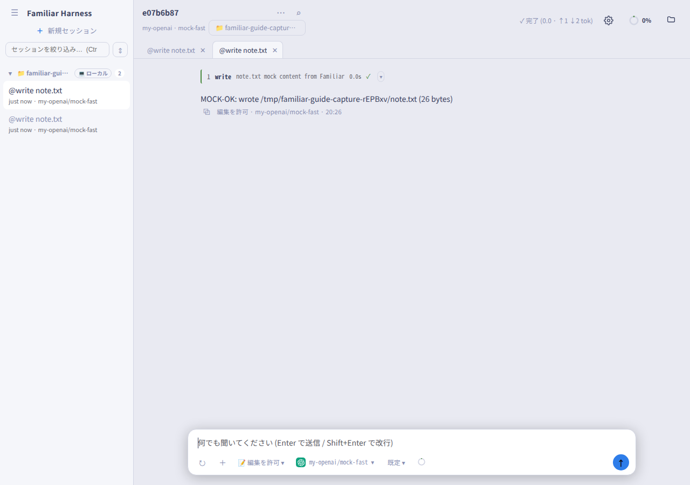
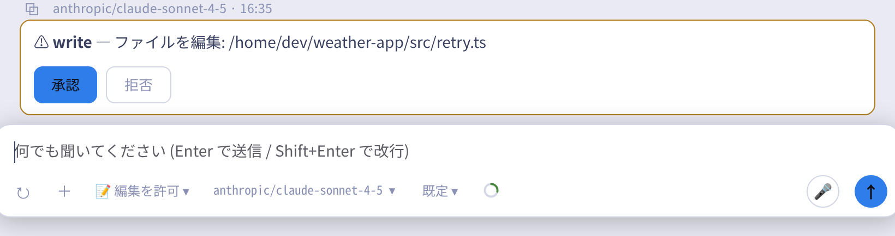
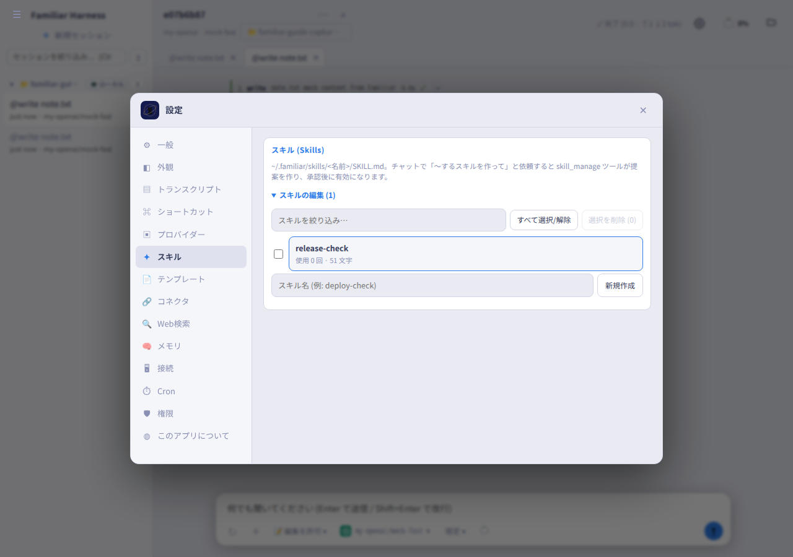
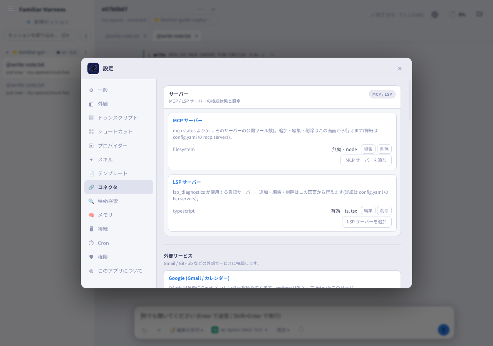
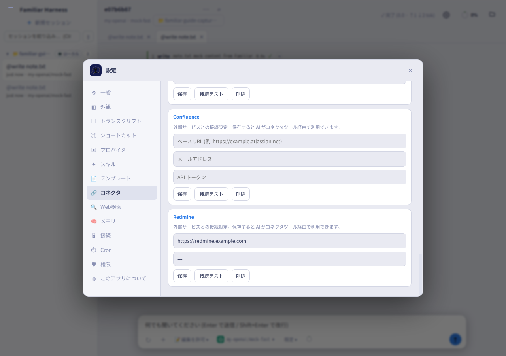
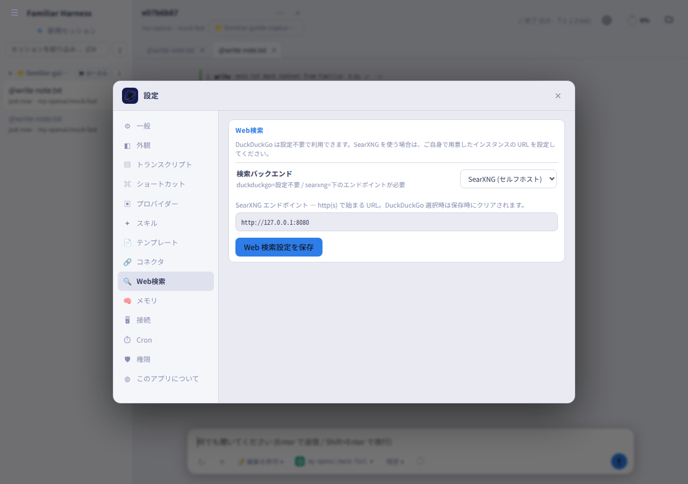
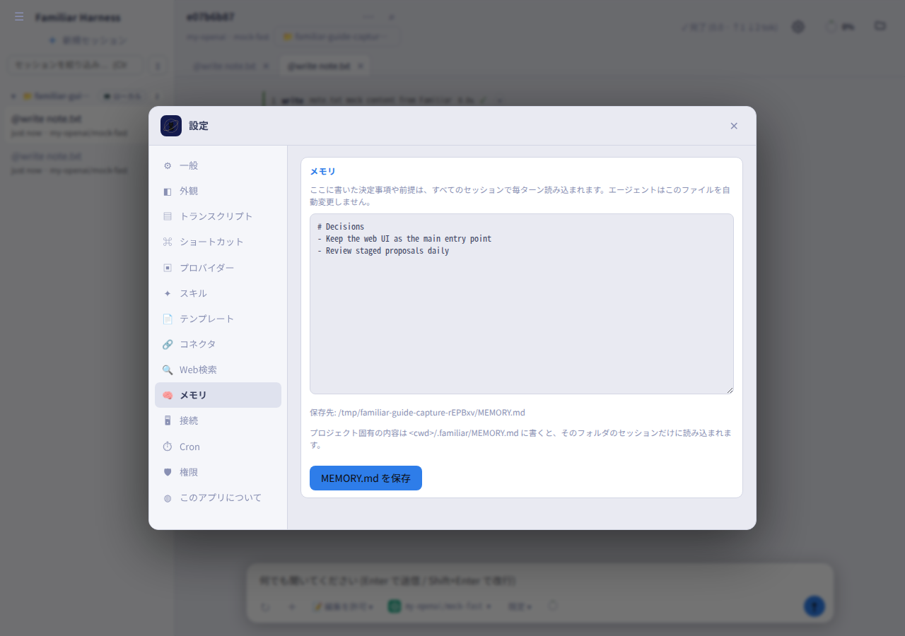
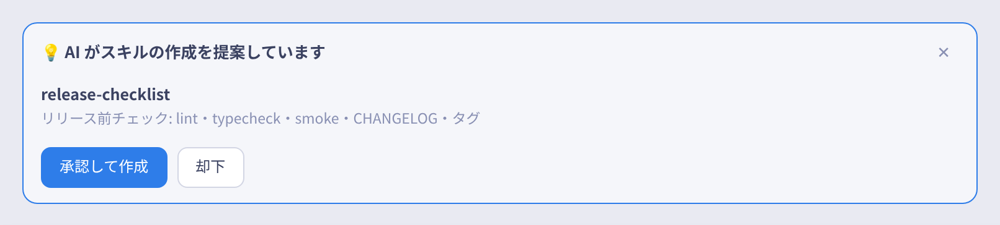

# Familiar Harness — ユーザーガイド

Familiar を「使う側」として使う方向けの、スクショ中心のガイドです。
以下の画面はすべてモックプロバイダと使い捨てホームで撮影した合成セッションで、
実際の会話や認証情報は含まれていません。

[English version](guide.md)

---

## 1. Familiar を起動する

Node.js 24+ が必要です。

```bash
curl -fsSL https://github.com/keima-tech/familiar-harness/raw/main/install.sh | sh
familiar            # 全画面 TUI
familiar run -p "このリポジトリの TODO を列挙して"
familiar serve      # Web UI + JSON-RPC (http://127.0.0.1:46210)
```

最初は Web UI が分かりやすいです。`familiar serve` が表示した URL を開くか、
デスクトップアプリ(deb / AppImage / NSIS)を起動すると専用サーバが立ち上がります。
セッションは SQLite に保存され、TUI・Web UI・デスクトップで共有できます。



API キーが無い場合は、実際に呼び出せる最初のプロバイダ(ローカルの Ollama など)
を使います。固定したい場合は `~/.familiar/config.yaml` で指定してください。

## 2. 最初の会話

- 入力して `Enter` で送信(`Shift+Enter` は改行)
- ツール呼び出しは **番号付き1行**で表示。行をクリックすると引数と結果が展開され、
  write/edit は unified diff が表示されます
- 危険な呼び出しは承認で止まります。実行内容がカードに表示されます。
  Plan モードでは読み取り専用ツールだけが使えます



入力欄の `+` からファイルを添付できます。画像はモデルへ渡し、それ以外は
`@<path>` として挿入され、エージェントがファイルツールで読みます。
`.zip` は展開不要で、`ziplist` / `zipread` の中身を一覧・閲覧できます。

TUI の操作: `Ctrl+P` コマンドパレット、`/models` モデル選択、`Tab` 権限モード切替、
`Esc` 停止、`/help` ヘルプ。

## 3. 設定のツアー

上部の歯車から設定を開きます。左側は目的ごとに項目が分かれています。

### スキル



スキルは再利用できる手順のカタログです。エディタ、または
`~/.familiar/skills/<名前>/SKILL.md` の直接編集で作成できます。
共有/グローバルなルートのスキルは読み取り専用で、ここでは削除できません。

### コネクタ — サーバー



MCP / LSP サーバーは枠で囲まれた **サーバー** グループにあります。
各カードの **追加 / 編集 / 削除** で `config.yaml` を触らずに設定でき、
保存すると稼働中のサーバへ反映されます。無効なサーバーも一覧に残り、
起動中の MCP サーバーは行のボタンで再接続できます。

### コネクタ — 外部サービス



外部サービスはサーバーの下にある別セクション **外部サービス** にあります。
名前は GitHub / GitLab / Jira / Microsoft Teams などの公式表記のままです。
認証情報を入力して **保存** → **接続テスト** を押します。保存済みシークレットは
API 応答ではマスクされ、平文で返ることはありません。

### Web 検索



Web 検索は DuckDuckGo なら設定不要で動きます。自前の SearXNG を使う場合は
ここで選択してエンドポイントを入力してください。`http(s)` URL のみ受け付け、
DuckDuckGo を選ぶと入力はクリアされます。

### メモリ



メモリは `~/.familiar/MEMORY.md` を編集する画面です。全セッションに知らせたい
決定事項や前提を書くと、毎ターン・全セッションでプロンプトに注入されます。
エージェントが自動で書き換えることはありません。

プロジェクト固有の内容は `<cwd>/.familiar/MEMORY.md` に書きます。そのフォルダの
セッションだけに読み込まれ、グローバル版より優先されます。

### 権限

権限では bash の allow/ask/deny ポリシーとルールテスタを設定します。
既定では通常コマンドは承認なし、破壊的・外部送信系は承認、マシンを壊すコマンドは
常にブロックです。

## 4. 決めたことを残す

2つの仕組みが補完し合います。

| 仕組み | 誰が書くか | 読み込み |
|---|---|---|
| `MEMORY.md`(グローバル/プロジェクト) | あなた(エディタまたは設定 → メモリ) | 毎ターン全文 |
| 長期メモリストア | レビュアーエージェント(あなたの承認後) | 毎ターン、関連度順 |

会話を閉じても残したい決定は `MEMORY.md` へ。エージェントが見つけた学びは
メモリストアへ、という使い分けです。



ターン後にレビュアーが memory / skill の提案を staging することがあります。
承認するまで反映されません(`familiar memory approve <id>` /
`familiar skills approve <id>`)。`familiar demo` でオフラインで流れを確認できます。

## 5. リモートマシン

別のホストで作業する方法は2つです。

- **SSH プロキシ** — リモートに何もインストールしません。bash とファイルツールが
  SSH 経由で動き、MCP サーバーや言語サーバーもそちらで起動できます
- **familiar-server** — ホストで `familiar serve` を起動し、アプリをそこへ向けます。
  ローカルトンネルが UI と RPC を運びます

ホスト鍵はフィンガープリントで確認してから登録します。リモートセッションでは
入力欄の添付ファイルもリモート側へアップロードされます。

## 6. セキュリティの基本

- `familiar serve` の既定の待ち受けは `127.0.0.1` です。ループバック外へ開くには
  `server.auth_token_file` が必要で、無い場合は起動を拒否します
- Web UI はトークン入力ページで一度だけ受け取り、その後は Cookie を使います。
  WebSocket も同じ認証です
- `FAMILIAR_READONLY=1` で起動すると read-only サーバーになり、認証済みでも
  設定・認証情報・ファイル変更系 RPC は拒否されます
- 通信は平文 HTTP/WS です。マシン外へ公開する場合は信頼できるネットワーク、
  トークン、TLS プロキシを使ってください

## 7. 次に読むもの

| 項目 | ドキュメント |
|---|---|
| 設定リファレンス | [spec/05-config.md](spec/05-config.md) |
| ツールと承認ルール | [spec/03-tools.md](spec/03-tools.md) |
| 自己改善の詳細 | [spec/04-self-improvement.md](spec/04-self-improvement.md) |
| JSON-RPC メソッド | [spec/02-protocol.md](spec/02-protocol.md) |
| アーキテクチャ | [spec/01-architecture.md](spec/01-architecture.md) |
| 変更履歴 | [CHANGELOG.ja.md](../CHANGELOG.ja.md) — 英語版: [CHANGELOG.md](../CHANGELOG.md) |

仕様は日本語、コードと CLI は英語です。
