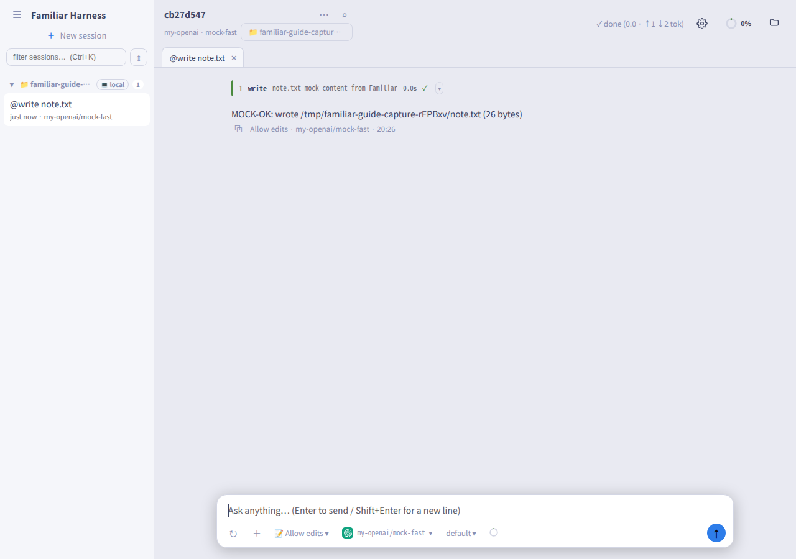
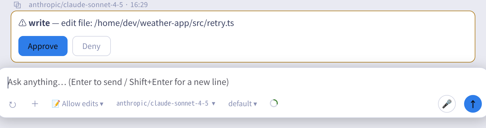
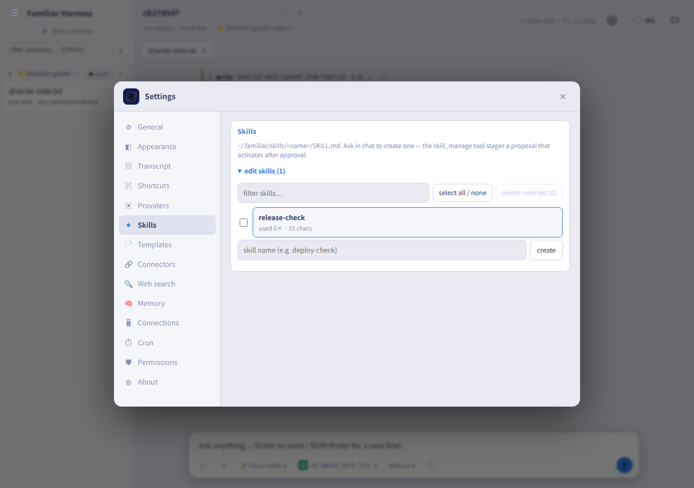
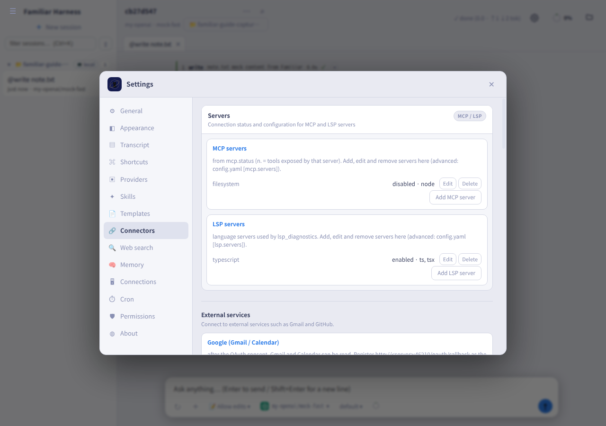
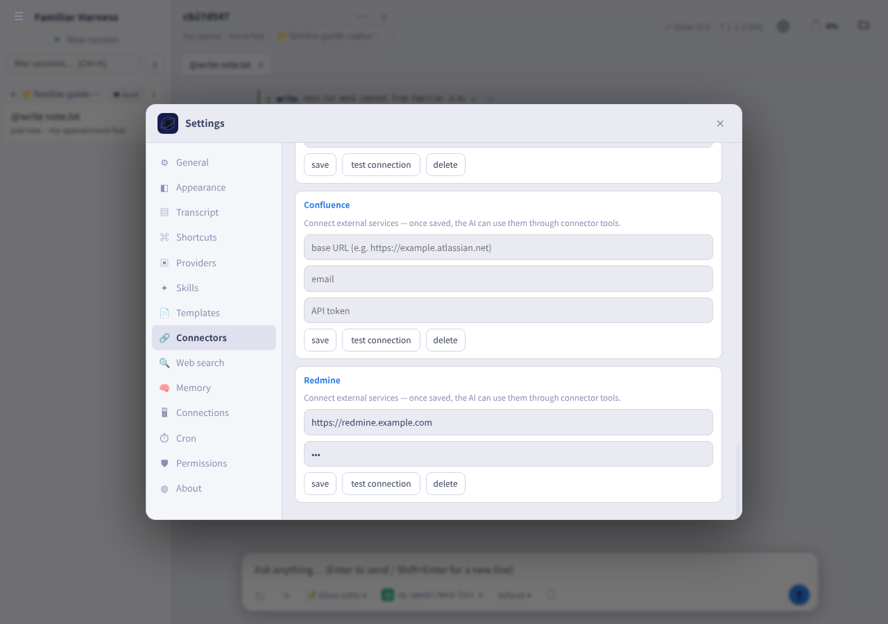
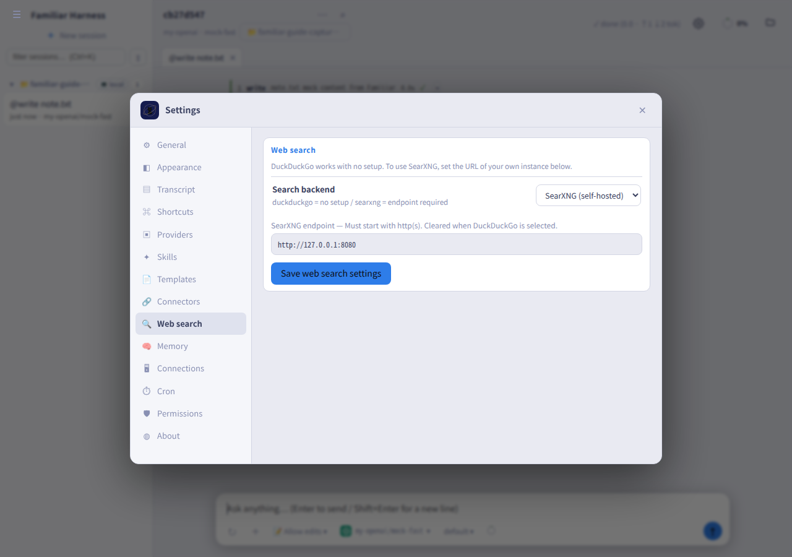
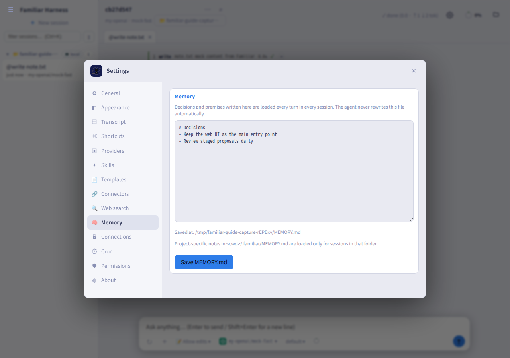
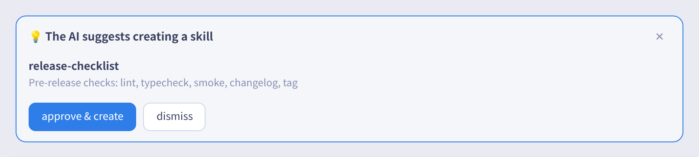

# Familiar Harness — User Guide

A screenshot-first walkthrough for people who want to use Familiar, not maintain it.
Every screenshot below comes from a synthetic session with a mock provider and a
throw-away home directory — no real conversation or credentials are shown.

[日本語版 / Japanese](guide.ja.md)

---

## 1. Start Familiar

Requires Node.js 24+.

```bash
curl -fsSL https://github.com/keima-tech/familiar-harness/raw/main/install.sh | sh
familiar            # full-screen terminal UI
familiar run -p "List the TODOs in this repo"
familiar serve      # web UI + JSON-RPC on http://127.0.0.1:46210
```

The web UI is the easiest place to learn the product. Open the URL printed by
`familiar serve`, or start the desktop app (deb / AppImage / NSIS) and it will
launch its own server. Sessions are stored in SQLite and shared between the TUI,
the web UI and the desktop app.



If no API key is configured, Familiar uses the first provider it can actually
call (a local Ollama endpoint, for example). Pin a provider and model in
`~/.familiar/config.yaml` when you want a specific one.

### How it works

The agent engine lives in one core. The TUI, web UI and desktop app are clients
of `familiar serve`, which exposes the core over JSON-RPC and events. A **turn**
is one user request; each model call inside it is a **step**. Sessions — messages,
tool calls and results — are stored in SQLite and shared by all frontends, so you
can start in the terminal and continue in the browser.

### Configuration basics

Settings live in `~/.familiar/config.yaml` (created on first run). The keys you
are most likely to touch:

```yaml
default_provider: ollama        # provider name; omit to auto-pick a usable one
server:
  port: 46210
  # auth_token_file: ~/.familiar/server.token   # required for non-loopback binds
permissions:
  bash: { mode: allow }         # allow / ask (destructive commands are still blocked)
  websearch: { provider: duckduckgo, base_url: "" }
memory:
  write_approval: true          # staged proposals need your approval
```

Skills, connectors, web search, memory and permissions are easier to edit in the
web UI (Settings); changes are written back to the same files. `.yaml` comments
document the remaining options.

## 2. Your first conversation

- Type a request and press `Enter` (`Shift+Enter` adds a newline).
- Tool calls appear as **numbered one-line rows**. Click a row to expand its
  arguments and result; write/edit tools show a unified diff.
- Risky calls stop for approval. An approval card shows exactly what will run.
  In Plan mode only read-only tools are available.



Use the `+` button in the composer to attach files. Images are sent to the
model; other files are inserted as an `@<path>` reference so the agent can read
them with its file tools. A `.zip` does not need to be extracted: the agent uses
`ziplist` / `zipread` to list and read text entries inside it.

In the TUI: `Ctrl+P` command palette, `/models` provider/model picker, `Tab`
permission-mode toggle, `Esc` stop, `/help` for everything else.

## 3. Settings tour

Open the gear icon in the top bar. The left rail groups settings by task.

### Skills



The Skills section is the catalog of reusable procedures. Create and edit your
own with the editor or by writing `~/.familiar/skills/<name>/SKILL.md`. Skills
from shared/global roots are shown as read-only and cannot be deleted here.

### Connectors — servers



MCP and LSP servers live in a framed **Servers** group. Use **Add / Edit /
Delete** on each card to configure them without touching `config.yaml`; the
configuration is saved and applied to the running server. Disabled servers stay
visible in the list, and a running MCP server can be reconnected with the button
on its row.

### Connectors — external services



External services are in a separate **External services** section below the
servers. Names keep their official casing (GitHub, GitLab, Jira, Microsoft
Teams …). Fill in credentials, press **save**, then **test connection**. Saved
secrets are masked in API responses and never echoed back in clear text.

### Web search



Web search works out of the box with DuckDuckGo — no key or setup. If you run
your own SearXNG instance, select it here and enter its endpoint. The endpoint
must be an `http(s)` URL; choosing DuckDuckGo clears it.

### Memory



The Memory section edits `~/.familiar/MEMORY.md`. Write decisions and premises
you want every session to know; the file is injected into the system prompt on
every turn, in every session. The agent never rewrites it automatically.

For project-specific notes, write `<cwd>/.familiar/MEMORY.md`. It is loaded only
for sessions in that folder and takes precedence over the global file.

### Permissions

The Permissions section holds the bash allow/ask/deny policy and its rule
tester. By default ordinary commands run without a prompt, destructive or
data-leaving commands ask, and machine-wiping commands are always blocked.

## 4. Make decisions stick

There are two complementary mechanisms:

| Mechanism | Written by | Loaded |
|---|---|---|
| `MEMORY.md` (global / project) | You, in any editor or Settings → Memory | Every turn, in full |
| Long-term memory store | The reviewer agent, after your approval | Every turn, ranked by relevance |

Use `MEMORY.md` for things you decided and want to survive closing a
conversation. Use the memory store for lessons the agent discovered itself.



After a turn, a reviewer agent may stage a memory or skill proposal. Nothing is
applied until you approve it (`familiar memory approve <id>` /
`familiar skills approve <id>`). `familiar demo` walks through this loop offline.

## 5. Remote machines

Two ways to work on another host:

- **SSH proxy** — nothing is installed remotely. Bash and file tools run over
  SSH; MCP servers and language servers can be spawned there too.
- **familiar-server** — start `familiar serve` on the host and point the app at
  it. A local tunnel carries the UI and RPC traffic.

Host keys are verified by fingerprint before being trusted. Composer
attachments are uploaded to the remote host when the session is remote.

## 6. Security basics

- `familiar serve` binds to `127.0.0.1` by default. A non-loopback bind requires
  `server.auth_token_file`; the server refuses to start without it.
- The web UI accepts the token once on its entry page and then uses a cookie.
  WebSocket connections use the same authentication.
- Set `FAMILIAR_READONLY=1` to expose a read-only server: all configuration,
  credential and file-changing RPCs are rejected even for authenticated callers.
- Traffic is plain HTTP/WS. Use a trusted network, a token, and a TLS proxy when
  exposing the server beyond your machine.

## 7. Where to go next

| Topic | Document |
|---|---|
| Changelog | [CHANGELOG.md](../CHANGELOG.md) — Japanese: [CHANGELOG.ja.md](../CHANGELOG.ja.md) |

The code and CLI are in English; this guide and the changelog are available in both languages.
